# CHAT_SPRINT_1 — Sprint Archive

## Summary

Sprint 1 built the Gmail add-on Filter Editor (format/gmail_api/filters/cards layers, 41 tests, manifest + scopes, old Code.js retired). Live deploy hit stale-manifest and missing-consent issues, resolved by re-push and re-consent; list and labels load. C2, C3, forwarding scope and F3-F8 flows remain unverified live and are backlog. D5 caching skipped.

```mermaid
%%{init: {"sequence": {"messageFontSize": 14, "noteFontSize": 18, "actorFontSize": 14}}}%%
sequenceDiagram
    autonumber
    participant Bob
    participant User
    participant Cypher
    participant Smith
    participant Morpheus
    participant Mouse
    participant Neo
    participant Tank
    participant Trin
    participant Oracle
    participant All
    Note over Bob,All: 📅 2026-10-09
    Bob->>User: "init"
    Note right of Bob: "Bob Protocol initialized<br/>for GmailUnSucked. All<br/>persona state files are<br/>fresh/empty, CHAT.md had<br/>no prior messages.<br/>Awaiting first task fro…"
    Cypher->>User: "pm new project"
    Note right of Cypher: "New project: PRD v0.1 in<br/>docs/PRD.md. M1 = filter<br/>editor (readable list, c<br/>reate/edit/delete/duplic<br/>ate, search).<br/>Constraint: Gmail<br/>Filters A…"
    Cypher->>Smith: "handoff"
    Note right of Cypher: "PRD v0.2: user answers<br/>folded in. Side panel M1<br/>(logic kept web-app-<br/>ready), forwarding IN,<br/>bulk/import/export OUT,<br/>personal use. Stories<br/>F1…"
    Smith->>Cypher: "user review"
    Note right of Smith: "Gate 1: APPROVED WITH<br/>NOTES. Fold into AC:<br/>concrete plain-language<br/>examples+sort/paging<br/>(F1), form validation +<br/>label/forwarding<br/>dropdowns…"
    Cypher->>Morpheus: "handoff"
    Note right of Cypher: "PRD v0.3: Smith notes<br/>folded into AC, F8<br/>(create filter from open<br/>message) added as P1 per<br/>user. M1 = F1-F6, F8.<br/>@Morpheus *lead arch<br/>docs/…"
    Morpheus->>Smith: "handoff"
    Note right of Morpheus: "Arch done: docs/ARCH.md.<br/>Layers format/gmail_api/<br/>filters/cards so a web<br/>app can reuse<br/>filters.js. Edit=create-<br/>then-delete w/ partial-<br/>failur…"
    Smith->>Morpheus: "init"
    Note right of Smith: "Smith online for Gate 2:<br/>reviewing docs/ARCH.md<br/>for UX impact. State<br/>loaded (Gate 1 notes 1-8<br/>are my checklist)."
    Smith->>Mouse: "handoff"
    Note right of Smith: "Gate 2: APPROVED WITH<br/>CONDITIONS. C1 edit must<br/>round-trip fields the<br/>form cannot represent<br/>(no silent data loss)<br/>with unit test, C2 keep<br/>se…"
    Mouse->>Neo: "init"
    Note right of Mouse: "Mouse online: loading<br/>Smith's Gate 2<br/>conditions and ARCH<br/>section 7 to write the<br/>sprint plan in root<br/>task.md."
    Mouse->>Neo: "handoff"
    Note right of Mouse: "Sprint 1 plan in root<br/>task.md: 15 tasks over 4<br/>phases (foundation<br/>spike, core logic w/<br/>node tests, cards,<br/>verification). Smith<br/>conditions C…"
    User->>Tank: "request"
    Note right of User: "@Tank *devops set up<br/>build for test and CI/CD<br/>via clasp, all through<br/>bobp make targets (test,<br/>lint, push/deploy). Why:<br/>Sprint 1 needs repea…"
    User->>Mouse: "request"
    Note right of User: "@Tank *devops set up<br/>build for test and CI/CD<br/>via clasp, all through<br/>bobp make targets (test,<br/>lint, push/deploy). Why:<br/>Sprint 1 needs repea…"
    Tank->>User: "init"
    Note right of Tank: "Tank online. Loaded<br/>state, reading request:<br/>Makefile targets<br/>(test/lint/push/deploy)<br/>via bobp make + clasp<br/>CI/CD. Why: sprint needs<br/>repeata…"
    Tank->>Mouse: "handoff"
    Note right of Tank: "Build/CI done: Makefile<br/>(lint, test, check,<br/>push, deploy via clasp),<br/>.claspignore, GH Actions<br/>ci.yml (check on PR,<br/>push on main w/<br/>CLASPRC_…"
    Neo->>Trin: "init"
    Note right of Neo: "Neo online (state<br/>loaded). Sprint 1 Phase<br/>2 starting: T3-T5 core<br/>logic (format.js,<br/>gmail_api.js,<br/>filters.js) with node<br/>tests, incl. C1. Why…"
    Neo->>Trin: "swe handoff"
    Note right of Neo: "T3-T5 done: format.js,<br/>gmail_api.js, filters.js<br/>+ 31 node tests (C1,<br/>D1-D4 incl. failure<br/>matrix) green via bobp<br/>make test. Why: logic is<br/>ve…"
    Trin->>Neo: "init"
    Note right of Trin: "Trin online (state<br/>loaded). Reviewing T3-T5<br/>tests vs PRD AC and C1<br/>for gaps. Why: Phase 2<br/>gate before cards."
    Trin->>Neo: "qa handoff"
    Note right of Trin: "T6 pass: 33 tests cover<br/>AC for F1-F5, F8 and C1,<br/>added empty-list +<br/>paging cases. Gap: cards<br/>untestable in Node, will<br/>get manual checklist.…"
    Neo->>Trin: "impl"
    Note right of Neo: "Neo: starting Phase 3<br/>(T7-T11): cards.js,<br/>manifest update,<br/>contextual trigger,<br/>retire Code.js. Why: UI<br/>layer last, thin over<br/>FilterService."
    Neo->>Trin: "swe handoff"
    Note right of Neo: "Phase 3 done: cards.js,<br/>manifest (Gmail adv<br/>service,<br/>homepage+contextual<br/>triggers,<br/>labels+message.metadata<br/>scopes), Code.js<br/>retired. 41 tes…"
    Trin->>Morpheus: "qa handoff"
    Note right of Trin: "UAT (automated) pass<br/>41/41. Live checks need<br/>deployment:<br/>docs/QA_CHECKLIST.md. C2<br/>only wired-tested.<br/>@Morpheus *lead review"
    Morpheus->>Mouse: "lead review"
    Note right of Morpheus: "Review pass: layering<br/>clean, D1-D4/D6-D10<br/>honored, C1 via extras.<br/>D5 caching skipped (tech<br/>debt). Sprint build<br/>complete, live push/QA<br/>is us…"
    Oracle->>Smith: "ora groom"
    Note right of Oracle: "Groomed:<br/>decisions+lessons<br/>recorded (memory.md,<br/>lessons.md). Chat not<br/>archived until sprint<br/>closes. @Smith *user<br/>test sprint 1"
    Smith->>User: "user blocked"
    Note right of Smith: "BLOCKED: cannot user-<br/>test without a live<br/>deployment (needs user's<br/>clasp login + push).<br/>Checklist:<br/>docs/QA_CHECKLIST.md.<br/>Gate conditions C1…"
    Mouse->>Cypher: "retro"
    Note right of Mouse: "Retro: Neo: D5 cache<br/>skipped, Trin: C2 test<br/>shallow, Morpheus:<br/>verify forwarding scope,<br/>Mouse: sprint sized<br/>well, Cypher backlog:<br/>caching,…"
    Note over Bob,All: 📅 2026-10-10
    Mouse->>User: "status"
    Note right of Mouse: "Status: 12/15 done<br/>(80%), T1/T13 partial,<br/>T14/T15 blocked on<br/>user's clasp push +<br/>docs/QA_CHECKLIST.md. 41<br/>tests green. No new work<br/>since re…"
    Smith->>All: "user approve"
    Note right of Smith: "Live test: add-on<br/>deployed, list+labels<br/>load after re-consent.<br/>C2/C3/forwarding/F3-F8<br/>not individually walked,<br/>closed on user direction<br/>as…"
    Cypher->>All: "pm launch"
    Note right of Cypher: "Sprint 1 launched (M1<br/>Filter Editor) on user's<br/>direction. Backlog:<br/>live-verify<br/>C2/C3/forwarding<br/>scope/F8, D5 caching,<br/>label create, bulk cl…"
```

