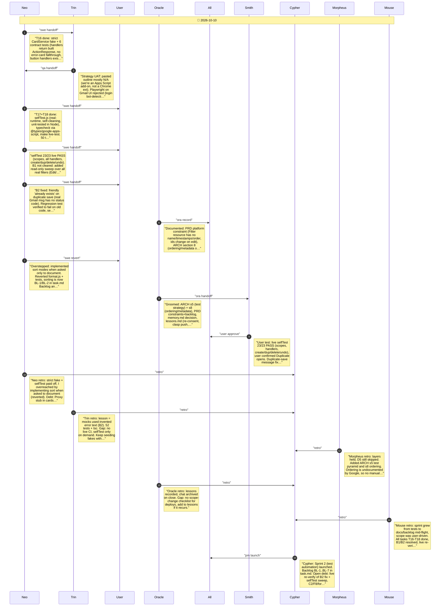

# CHAT_SPRINT_2 — Sprint Archive

## Summary

Sprint 2 (test automation) built a strict CardService fake with handler contract tests, a real-runtime selfTest() (23/23 live), and a typecheck lint layer; documented the test pyramid and Gmail filter ordering limits (no name/timestamps/order); fixed the duplicate-save friendly-error bug caused by invented mock error text. Live re-verify of the B2 fix and the real-filter sweep is pending; sorting and names are backlogged.

