# CHAT_SPRINT_3 — Sprint Archive

## Summary

Sprint 3 (UX enhancements) redesigned the filter list as one Card with one DecoratedText row per filter, label color dots, truncation, a detail card, small icon buttons, Enter-to-search and a growing list capped at 90, plus a chunked filter cache and editor polish. Built autonomously then reviewed; 75 tests and typecheck green; nothing pushed. Live checks (colors, dark mode, Enter behavior) are left for the user.

```mermaid
%%{init: {"sequence": {"messageFontSize": 14, "noteFontSize": 18, "actorFontSize": 14}}}%%
sequenceDiagram
    autonumber
    participant Trin
    participant All
    participant Neo
    participant User
    participant Cypher
    participant Oracle
    participant Smith
    participant Mouse
    participant Morpheus
    Note over Trin,Morpheus: 📅 2026-10-10
    Trin->>All: "qa verify"
    Note right of Trin: "Live re-verify passed:<br/>selfTest incl. real-<br/>filter sweep + F6<br/>friendly duplicate-save<br/>message. B1 closed, B2<br/>verified. Debt left: C2,<br/>F8, fo…"
    Trin->>All: "qa verify"
    Note right of Trin: "F8 live-verified by<br/>user. Debt left: C2<br/>(search/page<br/>persistence), forwarding<br/>scope, D5."
    Trin->>All: "qa verify"
    Note right of Trin: "Forwarding live-<br/>verified: works with<br/>gmail.settings.basic,<br/>sharing scope NOT needed<br/>(ARCH s3 spike<br/>resolved). Debt left:<br/>C2, D5."
    Neo->>User: "swe handoff"
    Note right of Neo: "D5 implemented at<br/>gmail_api.js: 60s per-<br/>user CacheService for<br/>labels+forwarding,<br/>invalidated on create,<br/>errors fall back to API,<br/>filters ne…"
    Trin->>Cypher: "qa verify"
    Note right of Trin: "C2 live-verified. M1<br/>acceptance fully live-<br/>verified, only D5 cache<br/>live selfTest re-run<br/>pending."
    Trin->>All: "qa verify"
    Note right of Trin: "selfTest 51/51 live<br/>PASS: 9 real filters x E<br/>dit/Duplicate/ConfirmDel<br/>ete, D5 cache, F6,<br/>create/delete/undo,<br/>cleanup. M1 fully<br/>verified, no c…"
    Oracle->>User: "ora record"
    Note right of Oracle: "README.md (dev/setup/tes<br/>ting/limits) and<br/>docs/USER_GUIDE.md (end-<br/>user) written,<br/>uncommitted. @User<br/>review, say when to<br/>commit+push"
    Cypher->>Smith: "pm handoff"
    Note right of Cypher: "Sprint 3 (UX polish,<br/>Tier 2) story+arch in<br/>docs/SPRINT3_UX.md: one<br/>collapsible CardSection<br/>per filter, label color<br/>as dot (no filled chips…"
    Smith->>Mouse: "user approve"
    Note right of Smith: "*user approve with<br/>conditions: (1) name<br/>always shown beside<br/>color dot, (2) tap<br/>targets:<br/>Edit/Duplicate/Delete<br/>stay reachable in <=1<br/>tap aft…"
    Mouse->>Morpheus: "sm handoff"
    Note right of Mouse: "Sprint 3 plan written to<br/>task.md (T19-T27, 4<br/>phases). Blocked only on<br/>user answers (button<br/>visibility, page size,<br/>dot color). @Morpheus<br/>*le…"
    Morpheus->>Neo: "lead handoff"
    Note right of Morpheus: "Plan approved: order<br/>spike -> fake -> pure<br/>cardModel -> cards -><br/>form. Neo starts T19/T20<br/>once user answers s6. No<br/>code written yet."
    Mouse->>User: "status"
    Note right of Mouse: "User answered Q1: try<br/>the overflow menu<br/>(developer preview),<br/>fall back to buttons in<br/>the expander. Added<br/>spike T19b, E1 updated.<br/>Q2 (page s…"
    Morpheus->>User: "lead decide"
    Note right of Morpheus: "User Q2: growing list<br/>over fully fetched, in-<br/>memory-searched filters<br/>(>1000 unusual), wants<br/>fluid search. Card<br/>Service has no client-<br/>side f…"
    Morpheus->>Neo: "lead handoff"
    Note right of Morpheus: "All 3 sprint-3 questions<br/>answered: overflow-menu<br/>(fallback expander),<br/>growing list + fluid<br/>search over fully<br/>fetched filters, colored<br/>dot+n…"
    Morpheus->>Neo: "lead decide"
    Note right of Morpheus: "User note: if overflow<br/>menu fails, use small<br/>icon buttons not word<br/>buttons. Plan updated<br/>(E1):<br/>ImageButton+setIconUrl<br/>with gstatic Material…"
    Morpheus->>Neo: "lead decide"
    Note right of Morpheus: "User revision: whole<br/>list = ONE Card, one<br/>DecoratedText widget per<br/>filter (not a section<br/>each). Expander -> tap<br/>opens detail card,<br/>single e…"
    Cypher->>User: "pm plan"
    Note right of Cypher: "Sprint 3 'UX<br/>enhancements': Stage 1<br/>only. Stories U1-U5 +<br/>decisions E1-E12 already<br/>in docs/SPRINT3_UX.md,<br/>draft below for user<br/>scope confir…"
    Cypher->>Smith: "pm handoff"
    Note right of Cypher: "Scope confirmed by user:<br/>U1-U7<br/>(docs/SPRINT3_UX.md<br/>s3+s7). Existing local<br/>code treated as Neo's<br/>phase-2/3 head start,<br/>reviewed in phase blo…"
    Smith->>Morpheus: "user approve"
    Note right of Smith: "*user approve revised<br/>stories (one widget per<br/>filter, detail card,<br/>icon buttons, Enter-to-<br/>search, growing list).<br/>Conditions unchanged:<br/>name…"
    Morpheus->>Smith: "lead handoff"
    Note right of Morpheus: "Arch s7 of SPRINT3_UX.md<br/>stands: E10<br/>DecoratedText row, E11<br/>detail card, E12<br/>icon/menu, E4 growing<br/>list cap 90, E9 chunked<br/>filter cache. Ov…"
    Smith->>Mouse: "user approve"
    Note right of Smith: "*user approve<br/>architecture. @Mouse<br/>plan"
    Neo->>Trin: "swe handoff"
    Note right of Neo: "Phase 2/3 impl complete:<br/>cardModel, filter cache,<br/>one-widget rows, detail<br/>card, editor polish,<br/>selfTest probes. 75<br/>tests + tsc. @Trin *qa<br/>u…"
    Trin->>Morpheus: "qa handoff"
    Note right of Trin: "UAT (automated) pass<br/>75/75 + typecheck.<br/>Contract tests cover:<br/>one section/one<br/>DecoratedText per<br/>filter, color dots,<br/>growing list cap 90, de…"
    Morpheus->>Oracle: "lead review"
    Note right of Morpheus: "Review pass: layering<br/>held (cards.js draws,<br/>format.js model,<br/>gmail_api.js cache).<br/>Note: filters now cached<br/>60s (amends D5),<br/>documented in A…"
    Oracle->>Smith: "ora handoff"
    Note right of Oracle: "Groomed: ARCH s9,<br/>USER_GUIDE list/edit<br/>sections, QA_CHECKLIST<br/>Sprint 3 UX, task.md<br/>close notes. @Smith<br/>*user test"
    Smith->>All: "user approve"
    Note right of Smith: "BLOCKED on live look:<br/>contrast/dark<br/>mode/Enter-to-search<br/>can't be tested offline.<br/>Approve to retro with<br/>live debt listed in<br/>task.md. @all *…"
    Neo->>Cypher: "retro"
    Note right of Neo: "Neo retro: model/view<br/>split paid off, cards.js<br/>row builder is dense,<br/>consider extracting<br/>later. Backlog: BL-1/2."
    Trin->>Cypher: "retro"
    Note right of Trin: "Trin retro: strict fake<br/>extended first (altText,<br/>widget limits) caught<br/>nothing wrong but pins<br/>rules. Gap: still no<br/>live render check."
    Morpheus->>Cypher: "retro"
    Note right of Morpheus: "Morpheus retro: platform<br/>limits drove design (no<br/>composite widget, no<br/>client code), record as<br/>the rule for future UI<br/>asks."
    Mouse->>Cypher: "retro"
    Note right of Mouse: "Mouse retro: sprint<br/>planned interactively,<br/>autonomous build ran<br/>ahead of planning once<br/>(lesson: confirm before<br/>building when user is<br/>mid-pl…"
    Cypher->>All: "pm launch"
    Note right of Cypher: "Cypher: Sprint 3 closed.<br/>Delivered U1-U7<br/>automated-verified, live<br/>checklist for user in<br/>task.md. Backlog<br/>BL-1/2/5/6/7 unchanged."
```

